# AISSS motion style guide

How every animated shot in the AI Safety Said Simply video looks and moves. The rules are enforced in code: the values live in `src/brand/tokens.ts`, the components in `src/` apply them, and `npm run check` fails when a shot breaks a rule a machine can see. This guide explains the rules for people and is the place to settle arguments.

**Where numbers come from.** Every value is tagged:

| Tag | Meaning |
|---|---|
| **PDF p.N** | From `branding/AISSS-Visual-Identity.pdf`, page N. Don't change without the brand owner. |
| **DECIDED** | A team decision for video. Change by agreement, then in `tokens.ts` only. |
| **EST** | Our best estimate. Replace with a measured value once a reference clip has been measured (see §15.4). |

If a case isn't covered here, take the quieter choice (PDF p.2).

---

## 0. One-page cheat sheet

**Canvas.** 1920×1080, 24 fps, H.264 for YouTube. Safe area: 120 px left and right, 96 px top, 120 px bottom. 12 columns of 118 px with 24 px gutters.

**Ground.** Warm Paper `#F4EFE6` with a static grain. Ink `#111111` for title, section and end cards only. Never white Paper in a Warm Paper frame.

**Panels.** Paper cutouts: Wool `#E3D5C3` (default) or Wheat `#CDBBA4` (second panel). Square corners, edges a hair off-true, a flat Wheat "shadow" 6 or 12 px down-right. No blur, no gradient, no rounded corners.

**Colour.** Strand `#C64D0A` does one job per frame: one word, one rule, one loop, one pin or one arrow. Signals (Indigo or Moss) are for diagrams, one per figure. Live `#FF8A3D` is a big fill or the highlighter, with Ink type.

**Type.** Baskerville Bold for titles (display 112, h1 88, h2 60). Baskerville Regular h3 46, caption 32. Baskerville Italic only for quotes, 56. Inter body 40, small 30, source 24. Labels are Inter Bold capitals 28 px, tracked 0.14 em. Left aligned. Body lines ≤ 42 characters, ≤ 3 lines. Hold text for 1 s + 3 words/s (minimum 2 s).

**Boil.** Shapes redraw every 3 frames (8 a second), cycling 3 drawings, ±3 px on panels. Text, the logo, photos and the Strand loop never boil.

**Motion.** Panels in 12 frames, text 10, small things 8, exits 8. Stagger 3 frames. Ease-out to enter, ease-in to leave, ease-in-out to move. Hard cut between scenes by default; paper push (14 frames) between chapters.

**Maps.** Only `<MasterMap>`. Equal Earth, Wool land, Warm Paper borders, Wheat shadow, one signal colour, named camera views, pins from the places list.

**Process.** Shots are code in `src/shots/S<chapter>-<shot>-<slug>/`. Before you hand off: `npm run check` passes, stills rendered and looked at, review checklist (§13.6) done.

---

## 1. Purpose, principles and how to use this

### 1.1 Why the guide is code

Many people and their coding agents are making shots in parallel. Written rules drift: one person's "small label" is 22 px, another's is 30. So the rules are stored once, as code:

- `src/brand/tokens.ts`: every colour, size, duration, easing and boil value.
- `src/` components: `<Ground>`, `<Cutout>`, `<Text>`, `<MasterMap>`, the cards and panels. Shots are built only from these.
- `scripts/check-style.mjs`: fails the build on raw hex colours, typed font sizes, shadows, blur, gradients, blend modes, rounded corners, centred text, home-made maps, ad-hoc easing, `Math.random`, rotation, and hand-placed logos.
- Runtime guards: `<Text>` throws when a line is too long or has too many lines, or when Strand is used below heading size; the map throws on unknown countries or labels that don't fit; the logo throws below its minimum size; the camera throws when it pushes text past 108%.

When the agent hits an error, the message says which rule and what to do instead.

### 1.2 Principles

1. **Plain first** (PDF p.3). Ink on Warm Paper, flat colour, square corners, no shadow blur, no gradient. The paper look comes from cut edges, flat offset shadows and the boil, not from effects.
2. **One colour job** (PDF p.3). Strand does one job in a frame. A second Strand item means the first one goes.
3. **Readable** (PDF p.3). Sentence-case headlines, small-caps labels, left-aligned text, short lines, long enough on screen to read twice.
4. **Explain, don't lobby** (PDF p.3). Visuals show the idea and its uncertainty. No doom imagery, no glitch or alarm effects.
5. **Same thing, same look.** A map is always the map, a lower third always the lower third. Reuse a component before building a new one.

### 1.3 How to use this

- **Making a shot:** read §0, copy `src/shots/_example/`, build from components, then follow §13.
- **Asking an agent:** the agent reads `AGENTS.md` automatically (Codex) or via `CLAUDE.md` (Claude Code). Prompt pattern in §15.2.
- **Changing a rule:** anyone can, from the same repo they make shots in. The easiest way is to ask your agent ("make labels 30 px", "add a Tokyo map view"); `AGENTS.md` tells it to change the value, this guide and the pictures together, then open a pull request titled `Rule: …`. By hand: change `tokens.ts` (or the component), update this guide, run `npm run check` and `npm run docs:stills`, and open the pull request. To fix wording in this guide only, you can edit it straight on GitHub (the pencil icon) without installing anything.

---

## 2. Canvas

| Item | Value | Source |
|---|---|---|
| Resolution | 1920 × 1080 | DECIDED (YouTube 16:9, no 4K) |
| Frame rate | 24 fps | DECIDED |
| Safe area | left 120, right 120, top 96, bottom 120 px | EST |
| Usable area | 1680 × 864 px | from the above |
| Grid | 12 columns × 118 px, 24 px gutters | EST |
| Column x | `colX(n) = 120 + n × 142` | code |
| Span width | `span(k) = k × 118 + (k − 1) × 24` | code |
| Spacing unit | 8 px: 8, 16, 24, 32, 48, 64, 96 | EST |
| Source line | 120 px from left, 56 px from bottom (below the safe area) | EST |

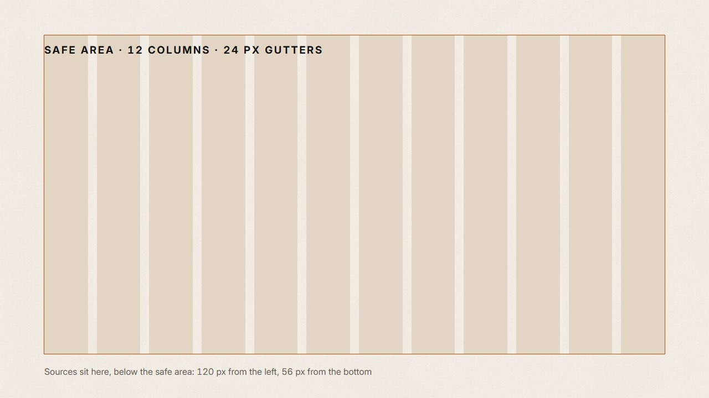

**Rules**

- Anything that must be read sits inside the safe area. The bottom margin is deeper because YouTube's player controls cover it when someone hovers.
- Left edges line up on column starts (`colX(0)`, `colX(6)` and so on). Widths are spans.
- Sources are the only text below the safe area.
- **End screen:** the last 10 s (240 frames) is the end card. Its right two-thirds stay empty for YouTube's end-screen elements (video and subscribe tiles).
- **Shorts / vertical:** not specced yet (TBD). When we need them we'll add a 1080×1920 canvas to the tokens rather than reframe by hand.

---

## 3. Colour in motion

### 3.1 The palette for video

| Name | Hex | Use in video | Never | Source |
|---|---|---|---|---|
| Warm Paper | `#F4EFE6` | The ground | In a frame with Paper `#FFFFFF` | PDF p.8 |
| Wool | `#E3D5C3` | Panels, lower thirds, map land, documents, photo mounts | — | PDF p.8 |
| Wheat | `#CDBBA4` | Second panel, chart bars, flat shadows, filler lines in documents | Text | PDF p.8 |
| Bark | `#5C534C` | Captions, sources, quiet labels on warm grounds; shadow under a Wheat panel | — | PDF p.8 |
| Ink | `#111111` | Text, axes, arrows, icons, Ink cards | Pure black beside it | PDF p.6–7 |
| Paper | `#FFFFFF` | Type and the logo on Ink only | As a panel or ground in a warm frame | PDF p.6 |
| Strand | `#C64D0A` | The frame's one accent | Body text, the logo, a second item | PDF p.6 |
| Clay | `#8C3410` | Small orange labels and icons | Headlines | PDF p.8 |
| Live | `#FF8A3D` | Big fills with Ink type; the highlighter | Text colour | PDF p.8 |
| Indigo | `#1B3A4B` | Signal: the highlighted bar, country or node | Headlines; next to Strand on one line | PDF p.8 |
| Moss | `#1E5C44` | Signal, alternative to Indigo | Same | PDF p.8 |
| Saffron | `#E2A100` | A tick or short underline in a diagram | A sentence, a fill behind text | PDF p.8 |
| Line | `#D4D4D4` | Quiet type on Ink | Text on light grounds | PDF p.7 |
| Ember | `#F57828` | Not used (website hover only) | — | PDF p.8 |

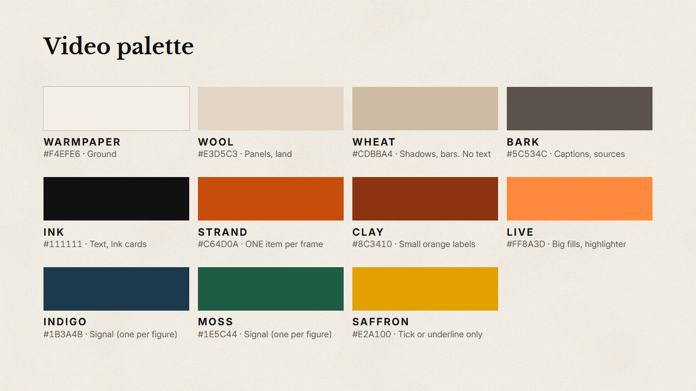

### 3.2 Grounds

- **Warm Paper** is the default ground for every content shot. **Ink** is for the title card, section cards if a chapter needs weight, and the end card. One ground per frame (PDF p.8).
- The ground carries a static grain (§5.3). The grain is baked into `public/textures/`; it never moves.
- On Ink there are no cutout shadows (a shadow on black is invisible), so depth there comes from layout only.

### 3.3 The one-Strand rule

A frame has **at most one** Strand-family item. Strand, Clay and Live all count as Strand family (DECIDED, from "an unlisted case gets the quieter choice"). One item means one of:

- one phrase in a heading (`<Text strand="...">`), or
- one Strand rule (`<StrandRule>`), or
- the Strand bar in a lower third, or
- one Strand loop, or
- one accent pin, timeline dot or arrow, or
- one Live highlight or Live panel.

If a lower third (which has a Strand bar) comes up over a map with an accent pin, drop the pin's accent. The code can't count accents across a frame, so this is on the review checklist.

### 3.4 Signals

Diagrams only (maps, charts, timelines, node diagrams). **One signal colour per figure**, plus Ink and the warm neutrals. Signals stay out of headlines and never sit on the same line as Strand (PDF p.8). The default is Indigo; use Moss when the figure means "confirmed" or when the shot next to it already uses Indigo for something else.

### 3.5 Type colour by surface (checked contrast, WCAG)

| Type | On | Ratio | Allowed for |
|---|---|---|---|
| Ink | Warm Paper | 16.5 | everything |
| Ink | Wool | 13.1 | everything |
| Ink | Wheat | 10.1 | everything |
| Ink | Live | 8.1 | everything |
| Bark | Warm Paper | 6.6 | captions, sources, quiet labels |
| Bark | Wool | 5.2 | captions, sources, quiet labels |
| Bark | Wheat | 4.0 | **not allowed** (quiet text on Wheat stays Ink) |
| Clay | Warm Paper | 7.0 | small orange labels |
| Strand | Warm Paper | 4.1 | **headings only (h3, 46 px and up)**; enforced |
| Strand | Wool | 3.3 | headings only |
| Paper | Ink | 18.9 | everything |
| Line | Ink | 12.7 | quiet text on Ink |
| Paper | Indigo | 12.0 | labels on a highlighted country or bar |
| Paper | Moss | 7.9 | labels on a highlighted country or bar |

`<Text>` picks Ink/Paper and the quiet colour from whatever it sits on, so you rarely set a colour yourself.

---

## 4. Type

### 4.1 Faces

| Role | Face in the brand (PDF p.10) | File we render with | Why |
|---|---|---|---|
| Sans | Inter | Inter (Regular, Medium, SemiBold, Bold), `public/fonts` | The brand's text face. Open source (SIL OFL), so it is bundled and every machine renders the same letters. |
| Serif | Baskerville | Libre Baskerville (Regular, Bold, Italic), `public/fonts` | The brand PDF's own stand-in. |

If the team licenses Baskerville, swap the serif files in `src/brand/fonts.ts` and nothing else changes. **Never** rely on system fonts: a Mac and a PC would draw different letters and the shots would stop matching.

Roles use weights 400 and 700 (Medium and SemiBold are loaded too, for the paper-collage style). Inter stays roman; no sans italic is loaded (PDF p.10). Redaction 35 is for the website hero only and isn't used in video.

### 4.2 Type scale at 1080p

| Role | Face | Size px | Leading | Tracking | Case | Max chars / line | Max lines | Use |
|---|---|---|---|---|---|---|---|---|
| `label` | Sans Bold | 28 | 1.2 | 0.14 em | CAPS | 40 | 1 | Kickers, "02 · CHAPTER", axis names |
| `display` | Serif Bold | 112 | 1.05 | −0.01 em | Sentence | 24 | 3 | Title card |
| `h1` | Serif Bold | 88 | 1.08 | −0.01 em | Sentence | 28 | 3 | Section cards, full-frame statements |
| `h2` | Serif Bold | 60 | 1.12 | 0 | Sentence | 34 | 2 | Panel, chart and lower-third titles |
| `h3` | Serif Regular | 46 | 1.2 | 0 | Sentence | 40 | 2 | Sub-heads, stat labels |
| `body` | Sans Regular | 40 | 1.3 | 0 | Sentence | 42 | 3 | The sentence on screen |
| `small` | Sans Regular | 30 | 1.3 | 0 | Sentence | 48 | 4 | Document text, timeline events |
| `quote` | Serif Italic | 56 | 1.25 | 0 | Sentence | 34 | 4 | Real quotes only |
| `caption` | Serif Regular | 32 | 1.3 | 0 | Sentence | 56 | 2 | Under photos and charts, Bark |
| `stat` | Serif Bold | 240 | 1.0 | −0.02 em | — | 8 | 1 | The big number |
| `figure` | Sans Bold | 34 | 1.1 | 0 | — | 12 | 1 | Values on bars, years on timelines |
| `source` | Sans Regular | 24 | 1.3 | 0 | Sentence | 90 | 2 | Citations, Bark. Smallest text allowed |
| `mapCity` | Sans Regular | 28 | 1.1 | 0 | Sentence | 24 | 1 | Pin labels |
| `mapRegion` | Sans Bold | 24 | 1.1 | 0.16 em | CAPS | 24 | 2 | Country or region names |

All sizes: EST, built on the PDF's roles (p.11). Body lines in print run 60–75 characters (PDF p.10); on screen we cap them at 42 (DECIDED) because viewers get one or two reads.

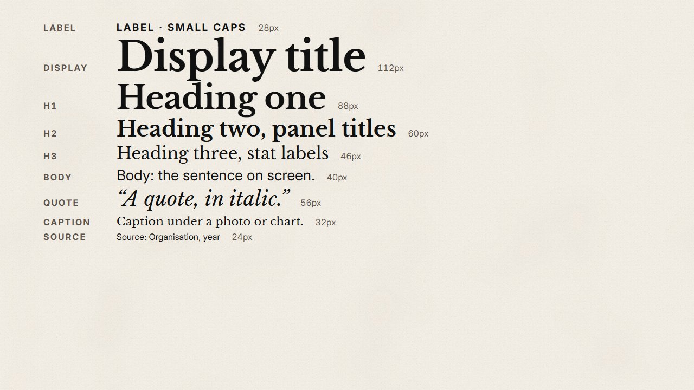

### 4.3 Writing on screen

- **Break lines yourself** with `\n`, at the pause you'd make reading aloud. Never let a line run to the edge and wrap.
- **Sentence case** for headlines (PDF p.3). Labels are capitals because they're set as small caps.
- **Left aligned, always.** Never centred, never justified (PDF p.10).
- **On-screen text is not the script.** Show the key words, not the voice-over. A full frame of text is ≤ 20 words.
- **Numbers:** digits, commas for thousands (`3,000`), `%` attached, currency `$190k`. Every number has a source line.
- **Quotes** use curly marks, which `<QuoteCard>` adds. Quote real people exactly.
- **The Strand phrase** in a heading should be its last clause ("Complex AI safety topics, *said simply*."), like the website hero (PDF p.11).

### 4.4 Reading time

`readFrames(text)` in tokens: hold = 1 s to notice + words ÷ 3 words/s, minimum 2 s (48 frames). A 9-word line holds 4 s (96 frames). The clock starts when the **last line has finished entering**. EST, from common subtitle guidance; check it against the voice-over pace.

---

## 5. The paper-cutout look ("AISSS paper")

DECIDED: the brand-strict reconciliation of the brand's flat rules with a Vox-style paper-cutout feel. The paper feel comes from four things only:

1. **Cut edges.** Panels are rectangles with **square corners**, but their edges are nudged off-true by up to ±1.6 px every 140 px, like scissors. Same seed, same cut, every render. (`CUT`, EST)
2. **Flat offset shadows.** The "shadow" is the same cut shape in solid Wheat, offset down and right. Under a Wheat panel it is Bark. No blur, no transparency, no grey. Light always comes from the top-left. (`ELEVATION`, DECIDED)
3. **Static grain.** A flat-toned fibre speckle (9% Bark) and a very faint mottle (1.8%) on the ground. It never moves. (`GRAIN`, EST)
4. **The boil** on shapes (§6).

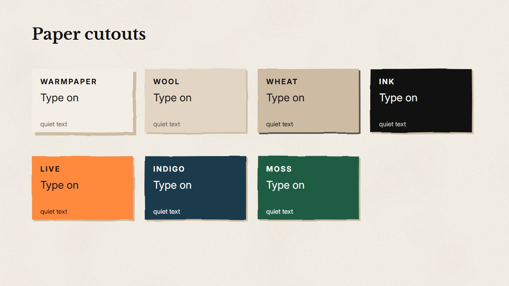

### 5.1 Elevation

| Level | Offset | Use |
|---|---|---|
| 0 | none | Things printed on the ground: chart bars, map land (which has its own 4 px shadow) |
| 1 | 6 px | Panels, lower thirds, callouts, quote cards |
| 2 | 12 px | Documents and photos, things "picked up" or on top of a panel |

Never more than three layers deep in one frame.

### 5.2 Layer order (back to front)

1. Ground colour, then the grain texture
2. Map or full-frame diagram
3. Panels and documents (elevation 1–2)
4. Photos and icons
5. Arrows and connectors
6. Text
7. The Strand item
8. Logo
9. Source line

### 5.3 Textures

- Grain is a baked PNG (`public/textures/grain-warm.png`, `grain-ink.png`). Re-bake with `npm run textures` after changing `GRAIN`.
- **No other textures**: no kraft paper, no torn edges, no tape, no folds, no photographed paper. They break "flat colour" and won't match between people.

---

## 6. The boil

One wobble preset, `<Boil>`, used everywhere. It is an SVG turbulence displacement whose seed changes every 3 frames and cycles through 3 drawings, so a still shape looks hand-cut and re-shot on each drawing.

| Setting | Value | Source |
|---|---|---|
| Redraw | every 3 frames at 24 fps (on 3s), so 8 drawings/s | EST (Vox-style boil is usually 8–12 fps) |
| Cycle | 3 drawings, then repeat | EST |
| Wobble size | 0.012 (long, gentle waves; one octave) | EST |
| Amount, panels | ±3 px | EST |
| Amount, lines and arrows | ±2.2 px | EST |
| Amount, icons | ±1.6 px | EST |
| Amount, map | ±1.4 px | EST |

**What boils:** panels and cutouts, chart bars, axes and timeline rules, arrows and connectors, icons, map land and borders.

**What never boils:** any text; the logo and yarn mark; photos (only their Wool mount boils); the Strand loop; the grain; pins and their labels.

All boiling elements step on the same frames, so the whole frame breathes together. Keep the boil running through holds: a held frame should never be frozen.

---

## 7. Motion language

### 7.1 Entrances and exits (`useEnter`, `<Text enter=...>`)

| Kind | What it does | Default duration | Used for |
|---|---|---|---|
| `rise` | up 24 px, fade in | 10 frames | Text, lists |
| `drop` | settles from 106% and 16 px up, fades in fast | 12 | Panels, callouts, photos, quotes |
| `slide-left` / `slide-right` / `slide-up` | slides in from off-frame, no fade | 12 | Lower thirds, documents, big sheets |
| `pop` | scales from 0 with a small overshoot (1.2) | 8 | Pins, icons, ticks, timeline dots only |
| `fade` | opacity only | 8–10 | Logo, sources, captions, map labels |
| `cut` | on, no motion | 0 | Anything on a hard cut |

Exits mirror the entrance, take 8 frames and use the exit curve. Lines of a text block enter 4 frames apart; items in a group 3 frames apart (one boil step). DURATIONS: EST.

**Not allowed:** spins, flips, 3D, bounces beyond the pop overshoot, typewriter effects, blur or motion blur, glitch, shake, zoom-blur, wipes with soft edges, letter-by-letter animation.

### 7.2 Easing (`src/motion/ease.ts`)

| Name | cubic-bezier | Use |
|---|---|---|
| `enter` | 0.22, 1, 0.36, 1 | Anything arriving |
| `exit` | 0.55, 0, 0.75, 0.06 | Anything leaving |
| `move` | 0.65, 0, 0.35, 1 | Things already on screen moving; the camera; drawing lines |
| `linear` | 0, 0, 1, 1 | Nothing visual; available for counters if needed |
| `pop` | back-out, overshoot 1.2 | Pops only |

All EST. Never `Easing.*` or `spring()` in a shot; the checker blocks them.

### 7.3 Timing reference (24 fps)

| Event | Frames | Seconds |
|---|---|---|
| Panel in | 12 | 0.5 |
| Text in | 10 | 0.42 |
| Small item in | 8 | 0.33 |
| Exit | 8 | 0.33 |
| Stagger, items | 3 | 0.125 |
| Stagger, lines | 4 | 0.17 |
| Arrow or rule draw | 18 | 0.75 |
| Highlighter swipe | 12 | 0.5 |
| Stat count-up | 30 | 1.25 |
| Bar grow | 18 | 0.75 |
| Strand loop draw | 36 | 1.5 |
| Logo in | 8 | 0.33 |
| Paper push | 14 | 0.58 |
| Map camera move | 48 | 2.0 |
| Fastest camera move | 36 | 1.5 |
| Shortest hold | 48 | 2.0 |

### 7.4 Choreography

- **Order:** container first (panel), then its title, then its body, then pointers (arrows), then the accent (Strand), then the source.
- **Talk first, then show:** an element enters on or just after the word that names it in the voice-over, never before.
- **One thing moves at a time** where possible. Two motions at once must be related (a panel and its text).
- **Exits:** clear the frame before a cut or let the push carry it. Don't leave half-finished exits at a cut.

### 7.5 Scene transitions

- **Hard cut:** the default between shots.
- **Paper push** (`paperPush()`): the new scene slides in as a sheet and pushes the old one off, 14 frames, `move` curve. Use between chapters and big changes of place or topic. From the right by default; from the bottom when going "deeper" into a detail.
- **Map continuity:** when two shots both use the map, end the first on a view and start the second on the same view, so the cut is invisible.
- **Not allowed:** dissolves, fades through white, wipes, zoom transitions, any `@remotion/transitions` preset other than `slide` via `paperPush()`.

### 7.6 Camera (`<Camera>`)

- Slow pushes and pans over a layout, eased with `move`, at least 36 frames between keys.
- With text on screen the camera never scales past **1.08**, because type would grow out of the type scale. (Enforced. Pass `textless` for a layout with no text.)
- Only the map zooms further, and it keeps labels and line weights constant while it does.
- No shake, no handheld drift, no rotation.

---

## 8. Components

Everything is imported from `src/aisss.ts`. Durations are suggestions for the composition length.

| Component | What it's for | Typical length | Strand use | Notes |
|---|---|---|---|---|
| `<Ground>` | Every shot's base | — | — | `ground="warm"` (default) or `"ink"` |
| `<Cutout>` | Any paper panel | — | — | `fill` wool, wheat, warmPaper, ink, live, indigo, moss; `elevation` 0–2 |
| `<Text>` | Every word | — | `strand="phrase"` (h3+) | `role`, `tone`, `at`, `exitAt`, `enter` |
| `<Source>` | Citation line | — | — | Required with any number or claim |
| `<TitleCard>` | Opens the video | 120 f | The loop | Ink ground, label, title, subtitle, logo, loop (PDF p.13) |
| `<SectionCard>` | Opens a chapter | 72 f | The rule | "04 · LABEL", h1, Strand rule |
| `<LowerThird>` | Names a person, place or idea | 96–144 f | The bar | Bottom-left, Wool, yarn mark right (PDF p.13) |
| `<Callout>` | Explains something on screen | 72+ f | Arrow may be Strand | Label, ≤3 body lines, optional pointer arrow |
| `<QuoteCard>` | A real quote | read time | The rule | Baskerville Italic, name · role |
| `<StatReveal>` | One big number | 96 f | Number may be Strand | Counts up, label, source |
| `<DocumentHighlight>` | A real document | 72+ f | The Live highlight | Filler lines are Wheat bars; quoted line is real text |
| `<PhotoCutout>` | A stock or real photo | — | — | Greyscale, Wool mount, tilt ≤ 2°, caption; §8.2 |
| `<ArticleCutout>` | A screenshot of a real article, post or page | 72+ f | Optional Strand underline | Greyscale, top-aligned, source line built in; §8.2 |
| `<Icon>` | Line icons | — | `tone="clay"` | 18 icons, sizes s 64 / m 96 / l 144, draw on |
| `<Arrow>` | Pointers and connectors | — | `tone="strand"` | Draws on, head snaps on |
| `<BarChart>` | Comparing amounts | 96 f | — | ≤ 8 bars, starts at zero, ≤ 1 highlight in a signal colour |
| `<Timeline>` | Dates in order | 96 f | One accent event | Spaced to scale |
| `<ItemList>` | 2–4 short items | — | — | Label + one body line each |
| `<MasterMap>` | Every map | — | One accent pin | §9 |
| `<LogoLockup>`, `<YarnMark>` | The logo | — | Never | §10 |
| `<StrandLoop>` | The brand loop | — | It is the item | §10 |
| `<EndCard>` | Closes the video | 240 f | — | Ink, logo, URL, empty right side for YouTube |
| `<Camera>` | Push or pan | ≥ 36 f per move | — | §7.6 |

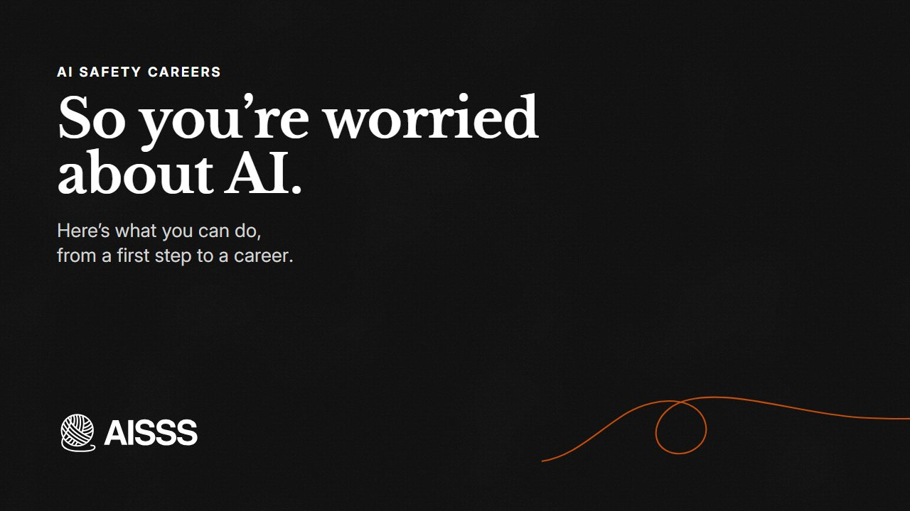

| | |
|---|---|
| 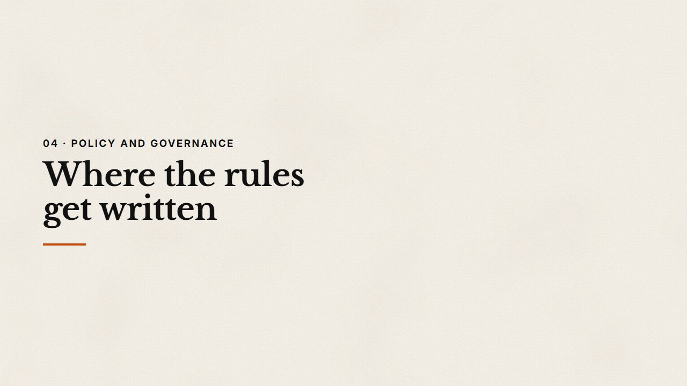 | 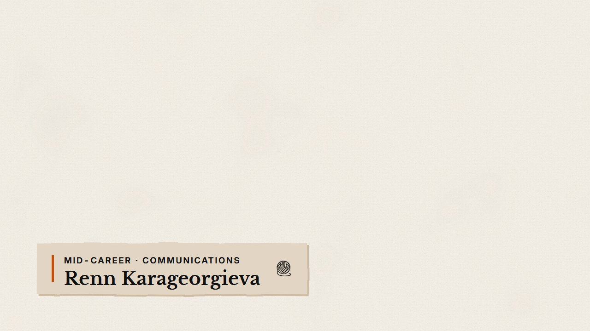 |
| 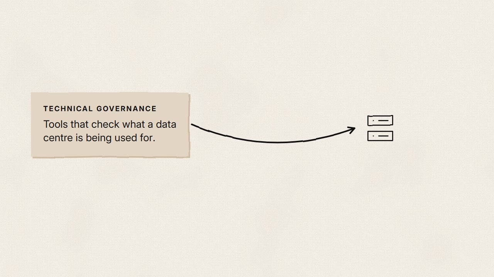 | 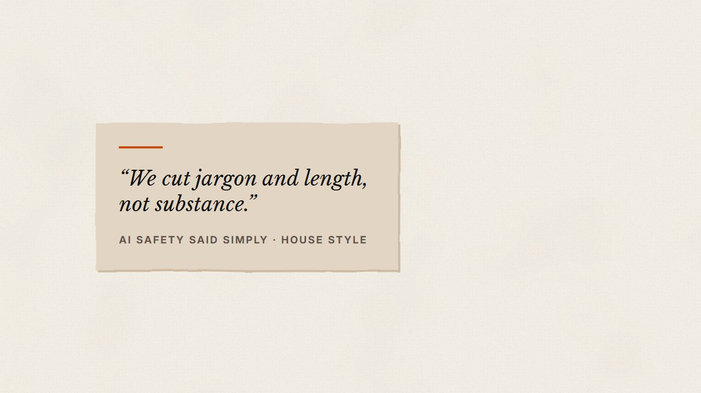 |
| 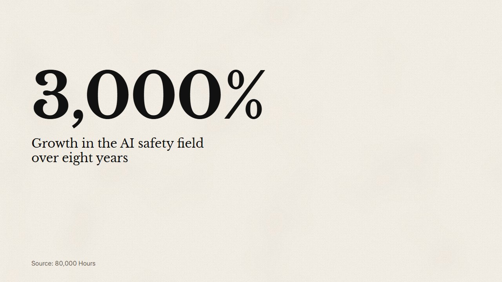 | 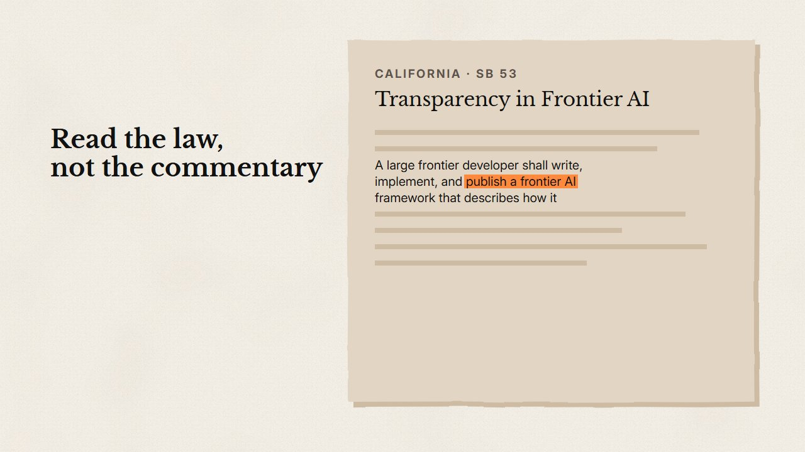 |
| 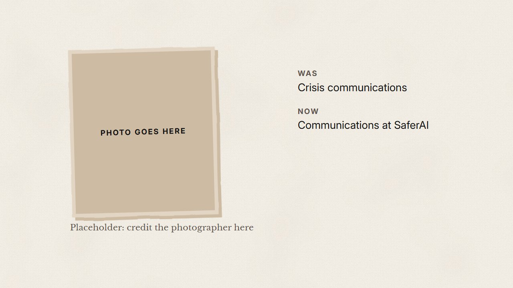 | 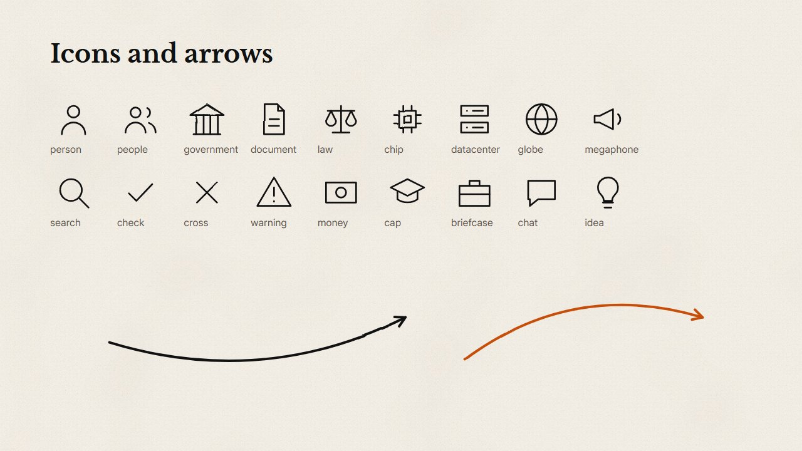 |
| 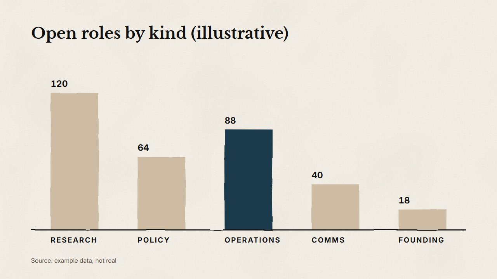 | 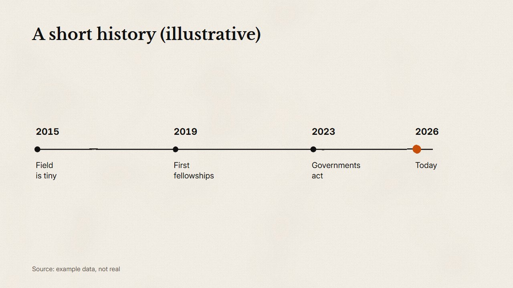 |

### 8.1 Rules per component

- **Lower third:** one per shot, on screen at least `readFrames(label + title)`, never over another panel. Width defaults to 7 columns.
- **Callout:** points at one thing. The arrow leaves from the panel edge facing the target.
- **Document:** only real documents. Show filler as Wheat bars rather than fake text. Highlight a phrase the voice-over reads.
- **Photo:** greyscale keeps photos inside the palette. Credit in the caption or the video description. No cut-out heads, no faces on bodies, no AI-generated people. Images rules in §8.2.
- **Charts:** bars start at zero. One idea per chart. The highlighted bar is the one the voice-over is talking about. The title says what the chart shows, not what to feel. Mark example data "illustrative".
- **Timeline:** years to scale; "today" is the accent if there is one.
- **Icons:** only from `ICONS`. New icons are drawn on the same 24-unit grid with the same stroke, added to `Icon.tsx`, and reviewed.
- **New components:** if two shots need the same new thing, it becomes a component in `src/components/` with props, not two copies.

### 8.2 Images

All images used in the video live in two folders in the repo. Each folder has a README with naming and capture rules, and a `credits.csv`; `npm run check` fails if an image has no credit row, is over 5 MB, or isn't JPG, PNG or WebP.

| Folder | What goes in it | Show with | Naming |
|---|---|---|---|
| `public/images/stock/` | Licensed stock photos: places, objects, everyday scenes | `<PhotoCutout>` | `data-centre-unsplash-x7k2.jpg` |
| `public/images/real/` | Real-story material: screenshots of articles, posts, documents, web pages; photos of the real people and events | `<ArticleCutout>` (screenshots), `<PhotoCutout>` (photos) | `2025-09-29-latimes-sb53-signed.png` (date published first) |

- **Everything is greyscale** on a Wool mount (DECIDED), so a newspaper's or a stock site's colours never compete with the palette. The colour on screen is ours: the Strand underline, a signal, the Live highlight.
- **Screenshots are evidence.** Never edit, retype or rearrange their words. Capture at 100% zoom, light mode, about 1600 px wide: headline, publisher, date, first paragraph. Crop out ads, banners and the browser bar. Every `<ArticleCutout>` shows its source line (publisher and date).
- **Underline, don't annotate.** To point at a line in a screenshot, use the `underline` prop (a Strand rule that draws on). No circles, arrows on top of the text, or highlighter over a screenshot.
- **Stock is for places and things**, never a stand-in for a real person in the story, and never the clichés: robots, glowing brains, circuit boards, hooded hackers. No AI-generated images of any kind.
- **Permission:** stock under a licence that allows YouTube use; news screenshots as commentary (record it in `permission`); photos of real people only with their permission or a suitable licence.
- **Size:** about 2400 px on the long edge is plenty. Keep originals elsewhere.

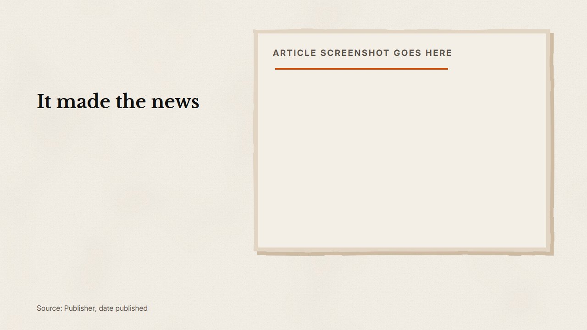

---

## 9. Maps

There is one map: `<MasterMap>`. No shot draws its own (the checker blocks `d3-geo` and atlas imports outside `src/map/`).

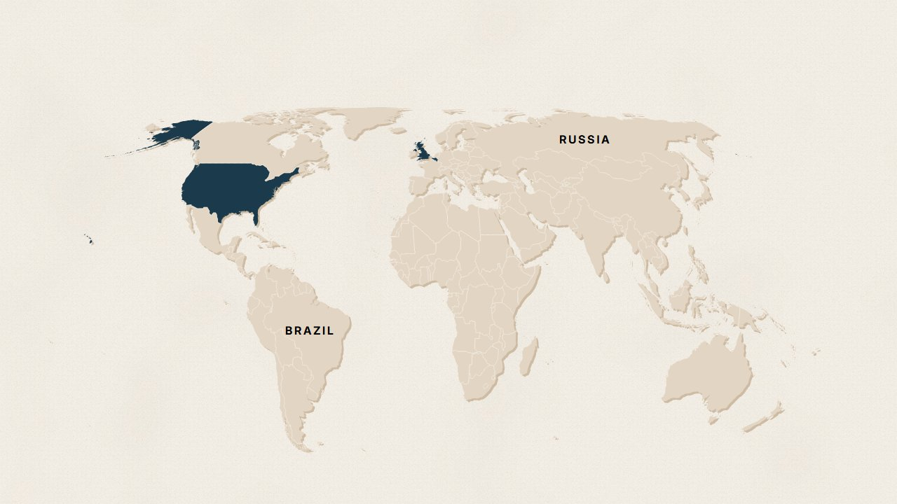

| Item | Rule | Source |
|---|---|---|
| Data | Natural Earth 1:50m countries (world-atlas 2.0.2), US states (us-atlas 3.0.1); public domain | DECIDED |
| Projection | Equal Earth, fitted once to the safe area; Antarctica removed | DECIDED |
| Land | Wool, with a flat Wheat shadow offset 4 px | DECIDED |
| Borders | Warm Paper, 1.5 px, so countries read as separate cut pieces; US states 1 px when shown | EST |
| Sea | The ground itself (Warm Paper); no blue | DECIDED |
| Highlight | One signal colour per map (Indigo default, Moss allowed), 12-frame fade from Wool | DECIDED |
| Pins | Ink dot, 11 px radius, Warm Paper ring 4 px; the accent pin is Strand (counts as the frame's Strand) | EST |
| Pin label | `mapCity` 28 px on a Warm Paper plate, right of the pin (or left with `side="left"`) | EST |
| Region label | `mapRegion` 24 px capitals; Bark on plain land, Paper on a highlighted country (must fit inside it; enforced) | EST |
| Boil | ±1.4 px on land and borders; pins and labels don't boil | EST |
| Places | Only from `src/map/places.ts` (one spelling, one coordinate) | DECIDED |
| Views | Only named views in `MAP_VIEWS`: `world`, `atlantic`, `northAmerica`, `usa`, `california`, `europe`, `ukBenelux`, `eastAsia` | DECIDED |

### 9.1 Animation

- **Camera moves** between named views over 48 frames with the `move` curve. Zoom eases in log space, so a world-to-city zoom feels even.
- **Line weights, pins and labels never scale** with the zoom.
- **Order:** camera arrives, then highlights fade in, then pins pop 6 frames apart, then labels. Don't pop pins while the camera is moving.
- **Countries** are named as in Natural Earth (`"United States of America"`, `"United Kingdom"`). A wrong name throws an error that suggests the right one.
- **Need a new view or place?** Add it to `MAP_VIEWS` or `places.ts` in its own commit, so everyone gets it.

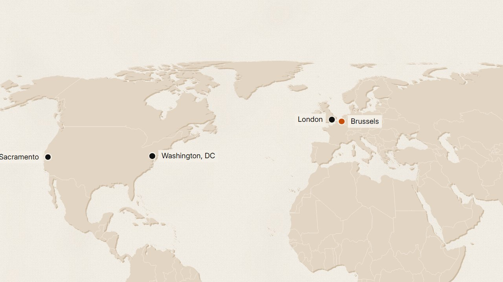
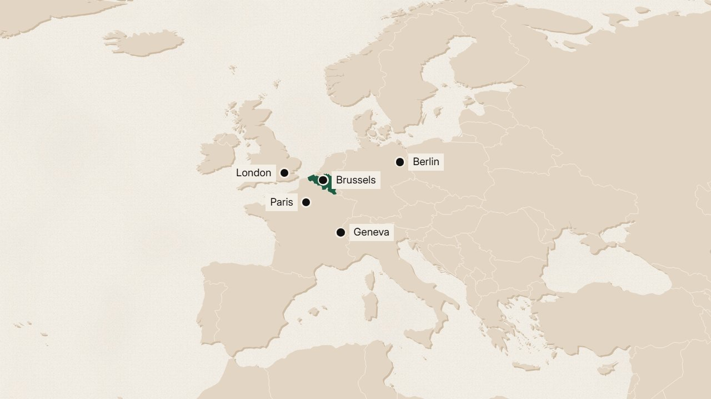

### 9.2 The career map

The interactive career flowchart (the website in `career-flowchart/` at the top of this repo) and the career map in the video are **the same map**. Its steps, people, paths and positions live in one file, `career-flowchart/careermap-data.js`. The website draws it; the video draws an exact copy of it with `<CareerMap>`.

**Changing the map** (a step, a link, a person, a position): edit `careermap-data.js` in the flowchart, check the website, then in this repo run `npm run sync:careermap` and commit the copied files (`src/careermap/careermap-data.js`, `src/careermap/logos.js`). Never edit the copies.

**Look** (the same on the website and in the video): neutral Wheat paths, Ink "getting started" trunk, Wool path labels with flat Wheat offsets, square corners, greyscale logos on white discs, Ink circles for things you do yourself. The path being talked about is **lit** in the one signal colour (Indigo): its line, its rings, its label. Strand is used once, for "You are here" (in the video) or the title clause (on the website).

**Animating it** with `<CareerMap>`:

| Prop | What it does |
|---|---|
| `camera` | Moves between named views over 48 frames: `overview`, `gettingStarted`, `start`, `learn`, `fork`, `student`, `mid`, `pick`, `paths`, `end`, a path (`policy`), or one stage of a path (`policy:2`) |
| `reveal` | Builds the map in story order: parts `start`, `learn`, `student`, `mid`, `pick`, each path id, `end`. Lines draw on, then steps pop in as the line reaches them, then the real people's pins |
| `ghost` | Shows the parts still to come as faint outlines (the "whole map, still to come" opening) |
| `lit` | Lights a path from a frame; `lane: null` turns it off |
| `here` | "You are here": a Strand ring that glides from step to step |

- Map text scales with the camera, so it fades out whenever it would be under 20 px on screen. Use path and stage views (`policy:2`) when the words need to be read; use `paths` or `overview` for shape only.
- Reveal a part before the camera arrives on it, or as it arrives; don't pan across empty paper.
- One path lit at a time.

| | |
|---|---|
| 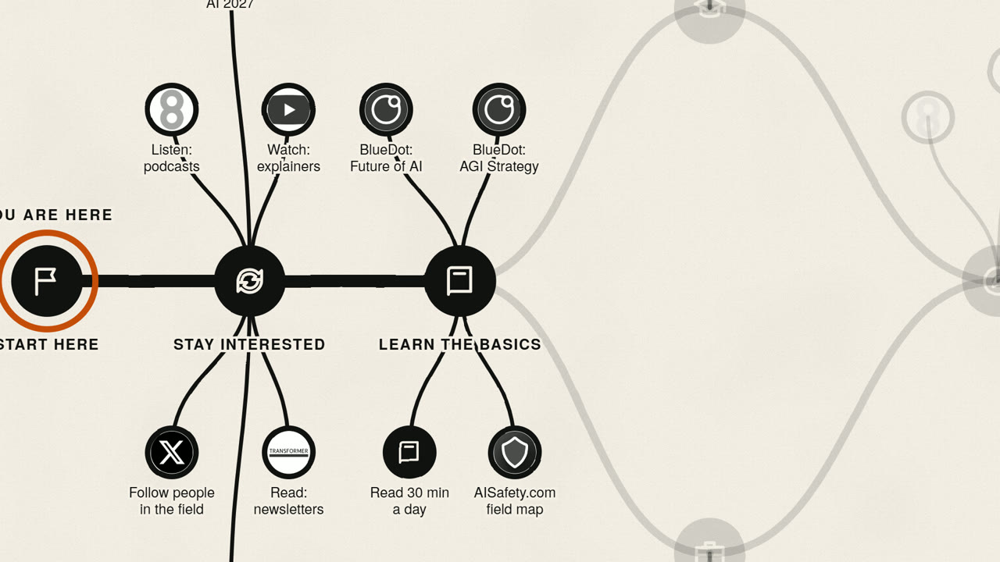 | 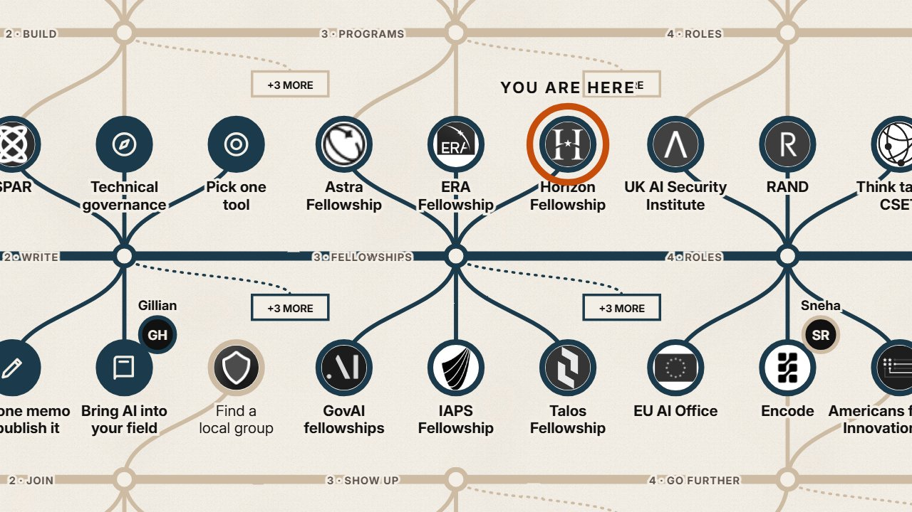 |

---

## 10. Logo and the Strand loop

### 10.1 Logo (PDF p.4–5)

- The lockup (yarn mark + "AISSS") is the only lockup; there is no stacked version. Use `<LogoLockup>`; below 128 px wide use `<YarnMark>` (minimum 28 px). Both throw below their minimums.
- Ink on light grounds, Paper on Ink. Chosen automatically from the ground. Never Strand, never two colours.
- Clear space = the mark's height on every side; it is built into the component as padding.
- **Animation:** fade (8 frames) or cut only. It never boils, draws on, spins, scales up from zero, bounces, flips or gets a glow, outline or shadow.
- Appears on the title card (bottom-left) and the end card. A yarn mark sits in lower thirds (PDF p.13). No corner watermark through the video.

### 10.2 Strand loop (PDF p.12)

- One open stroke with round ends that runs off the edge of the frame. **One loop per layout**; the loop is that frame's Strand item, so the headline is not Strand.
- Draws on once over 36 frames with the `move` curve, then holds still. It never boils, tiles, frames text or acts as a bullet.
- Scale it evenly; the stroke scales with it (3 px at scale 1).
- Used on the title card (bottom-right) and at most a few other "breathing" frames. Not on content-heavy frames.
- The current path approximates `strand-drift.svg`; when the official SVG is added to `public/brand/`, replace `LOOP_D` in `StrandLoop.tsx`.

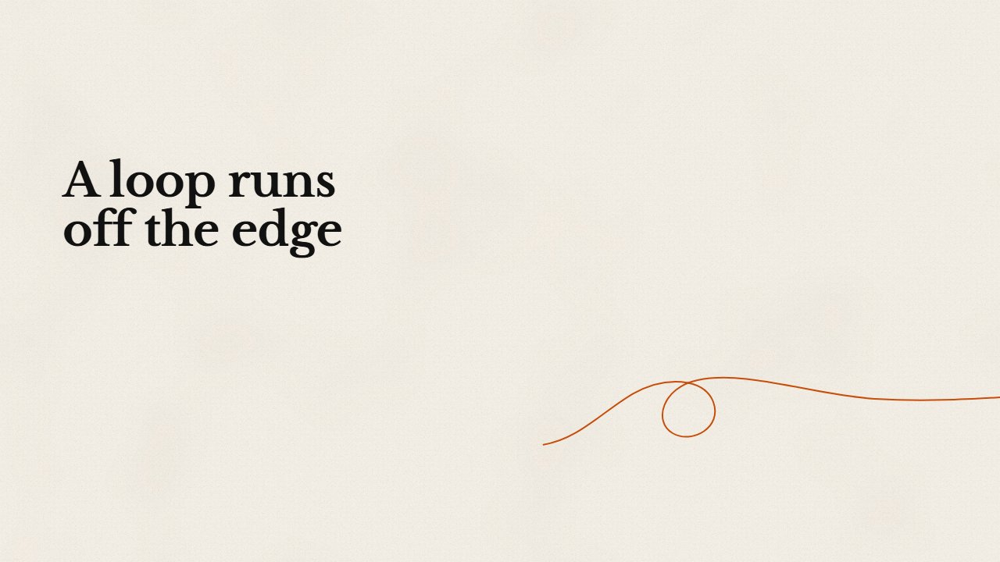

---

## 11. Sound (optional, TBD)

The brand PDF has no sound rules; these are EST starting points.

- **Paper foley only:** soft paper slides for slides and pushes, a light paper tap for drops, a pen scratch for arrows and the highlighter, a soft tick for pins. No whooshes, risers, booms, glitches or alarm sounds.
- **Levels:** effects sit well under the voice, about −24 to −18 dB relative to it. Mix to −14 LUFS integrated, true peak ≤ −1 dBTP (YouTube's normalisation target).
- **Sync:** sounds land on the frame the motion lands, not where it starts.
- **Files:** licensed sounds only, in `public/sfx/` with the licence noted in `public/sfx/LICENSES.md`. Added with Remotion's `<Audio>`.
- **Music:** low and steady under the voice; ducks under speech. Licence on file.

---

## 12. Accessibility

- **Contrast:** only the pairs in §3.5. Strand type only at heading size (enforced). No type on Wheat in Bark, Live as text, Saffron as text or Line 2 as text.
- **Reading time:** §4.4. Nothing important is on screen for less than 2 s.
- **Captions:** upload an accurate `.srt` to YouTube for the main video (don't burn captions in). Burned-in captions for shorts are TBD with the vertical spec.
- **Don't rely on colour alone:** a highlighted country or bar is also named in a label or the voice-over.
- **Flashing:** nothing flashes more than 3 times a second (WCAG 2.3.1). The boil is small displacement at 8 drawings/s, not a flash; don't boil big high-contrast areas faster than that or by more than the token amounts.
- **Motion:** no shake, strobing or fast zoom. Camera moves are at least 1.5 s.
- **Sources:** every number and claim on screen has a source line (§4.3), so viewers can check it.

---

## 13. Workflow

### 13.1 Where things live

| What | Where | Why |
|---|---|---|
| Rules, components, shots (code) | GitHub repo `cta-video`, folder `motion/` | Exact values, history, review, one source of truth |
| The career map (website and its data) | Same repo, folder `career-flowchart/` | The video's career map is copied from it (§9.2) |
| This guide, `AGENTS.md` | `motion/` | Changes with the code it describes |
| Brand package | Same repo, folder `branding/` | Source of truth for the brand |
| Fonts, logo SVGs, textures | `motion/public/` | Every render needs them |
| Stock images and real-story screenshots and photos | `motion/public/images/stock/`, `motion/public/images/real/` (§8.2) | Every render needs them; credits travel with them |
| Script, research notes | Same repo, folder `notes/` | Everyone works from the same script |
| Raw voice-over and music, reference clips, final renders | Shared OneDrive folder `cta/animation/` | Too big for git. Compressed voice-over and music that a render needs (MP3) go in `motion/public/audio/` |

**Don't work inside OneDrive.** Clone the repo to a normal folder (for example `C:\dev\cta-video` or `~/dev/cta-video`). OneDrive syncing `node_modules` and `.git` is slow and can corrupt the repo, and Windows path-length limits stop Remotion's browser from starting in long paths.

Shared OneDrive folder (big media only):

```
cta/animation/
  references/        reference clips + frames pulled with ffmpeg
  audio/             vo/, music/, sfx-source/ (raw recordings and masters)
  renders/           S04-02-policy-map_v003.mp4, Main_v012.mp4
```

### 13.2 Naming

- **Shot id:** `S<chapter 2 digits>-<shot 2 digits>-<slug>`, lower-case slug with hyphens: `S04-02-policy-map`. Enforced.
- **Folder:** `src/shots/S04-02-policy-map/` with `index.tsx` (or a named component file) and any shot-only helpers.
- **Images:** `public/images/stock/<subject>-<site>-<id>.jpg` and `public/images/real/<yyyy-mm-dd>-<publisher>-<slug>.png` (§8.2).
- **Branch:** `shot/S04-02-policy-map`.
- **Render:** `S04-02-policy-map_v003.mp4` in OneDrive `renders/`. The version goes up on every render you share; never overwrite a shared version.

### 13.3 Making a shot

1. Pull `main`. Make a branch.
2. Copy `src/shots/_example/` to `src/shots/S04-02-policy-map/`. Rename the component.
3. Register it in `src/shots/index.ts` (id, component, duration, `inMain: true` once it's in the cut).
4. Build it from components. Time entrances to the voice-over (put a VO slice in `public/vo/` while you work, or note the timings).
5. Preview: `npm run studio`.
6. `npm run check` until it passes.
7. `npm run stills -- S04-02-policy-map:<frame>` for 2–3 key frames, and look at them.
8. Go through the review checklist (§13.6).
9. Open a pull request with the stills attached. One reviewer approves before merge.

### 13.4 Versioning

- `main` always renders. GitHub runs `npm run check` on every pull request (`.github/workflows/check.yml`); merge only on a green tick.
- **Rule changes** (anything in `tokens.ts`, `src/brand/`, `src/paper/`, `src/motion/`, `src/map/`, `src/components/`, `src/type/` or the checker) affect every shot. They go in their own pull request titled `Rule: …`, with this guide and `docs/stills/` updated in the same pull request, a list of shots that now look different, and a heads-up to the team. One teammate approves.
- After a rule change is merged, everyone pulls `main` before their next shot, so all shots use the new rule.
- Dependency versions are pinned exactly in `package.json` and locked in `package-lock.json`. Use `npm ci`, not `npm install`, so everyone has the same versions.

### 13.5 Export settings

Set once in `remotion.config.ts`:

| Setting | Value |
|---|---|
| Codec | H.264 |
| CRF | 16 |
| Pixel format | yuv420p |
| Colour space | BT.709 |
| Frames | PNG (lossless before encoding) |
| Audio | AAC (Remotion default), 48 kHz |

Render a shot: `npx remotion render S04-02-policy-map out/S04-02-policy-map.mp4`. Render the whole video: `npx remotion render Main out/Main.mp4`. If someone edits in Premiere or DaVinci instead, export shots as ProRes 422 HQ (`--codec=prores --prores-profile=hq`) so colour doesn't shift twice.

### 13.6 Review checklist (things the checker can't see)

- [ ] `npm run check` passes.
- [ ] At most **one Strand-family item** in every frame (check frames with a lower third over a map or chart).
- [ ] One signal colour per figure.
- [ ] Every text block is readable for its hold time (`readFrames`), counted from when the last line lands.
- [ ] Elements enter on or after the word that names them.
- [ ] Every number and claim has a source line, and the source is real.
- [ ] Map: right places, right country names, pins not popping during camera moves.
- [ ] Nothing important outside the safe area; nothing under the end-screen area on the end card.
- [ ] Photos have permission and credit.
- [ ] The shot cuts cleanly into the shots before and after (matching map views, same ground).
- [ ] Stills attached to the pull request.

---

## 14. Do and don't

Rendered from `src/gallery/dont/DoDont.tsx` (the only files allowed to break rules, on purpose).

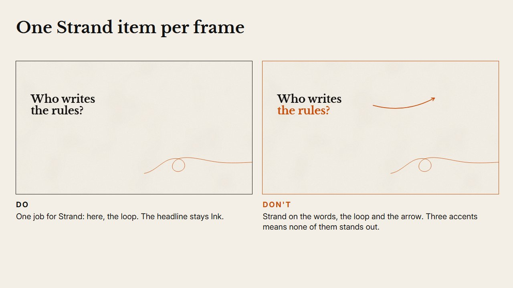
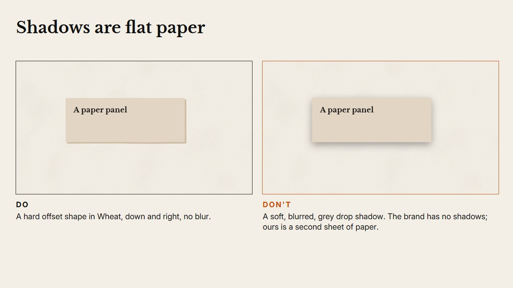
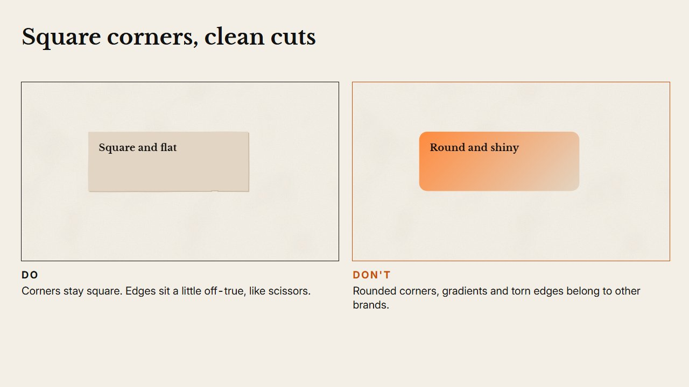
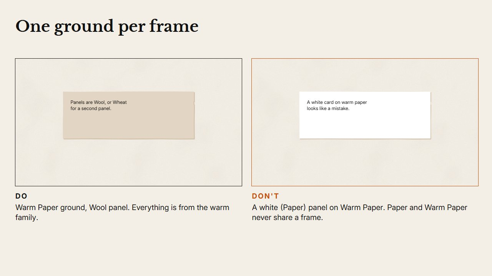
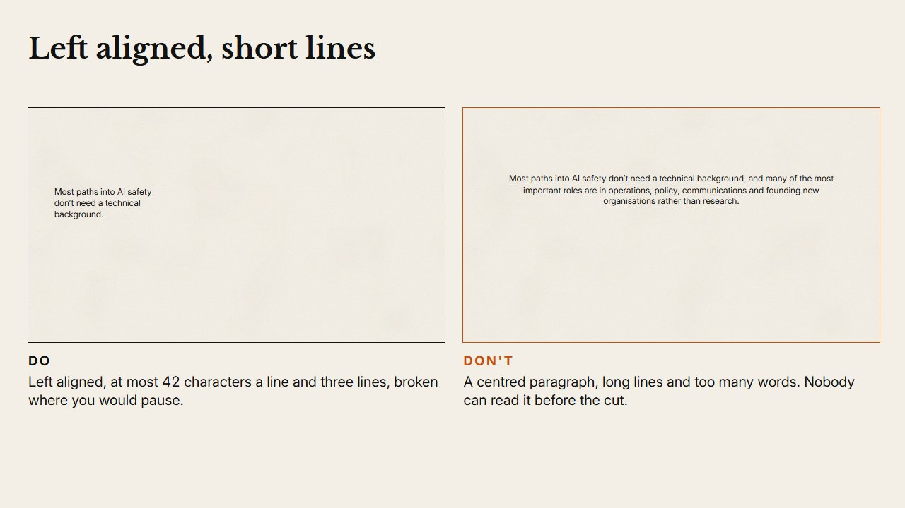
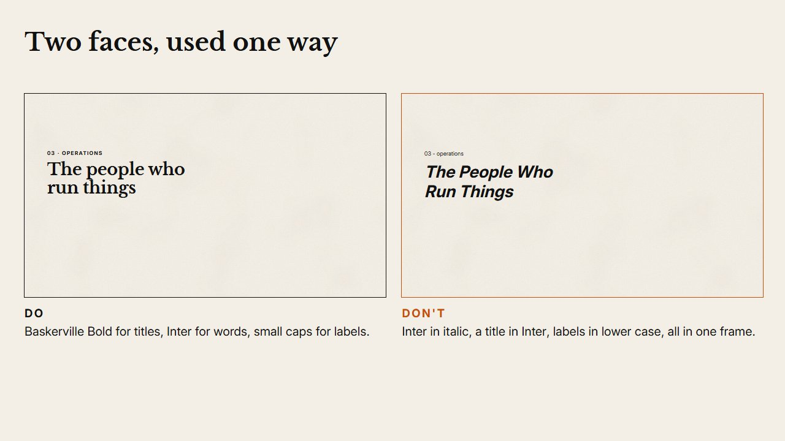
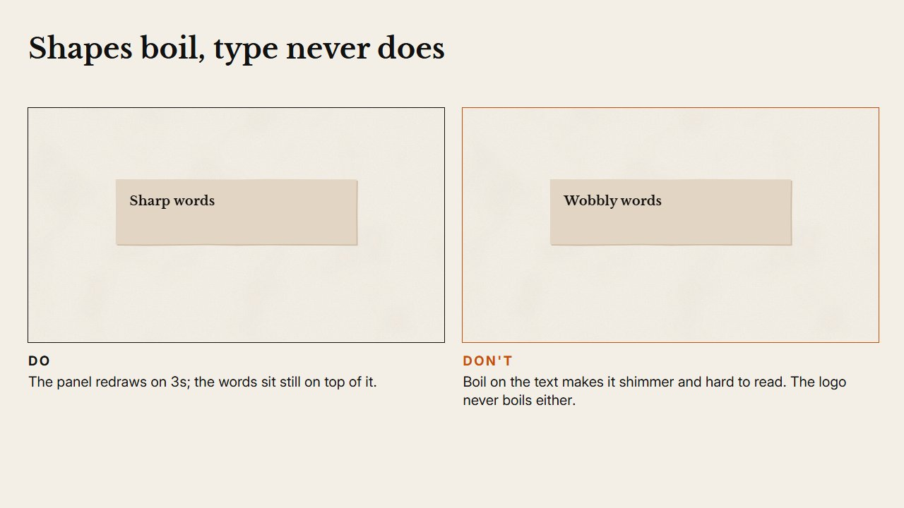
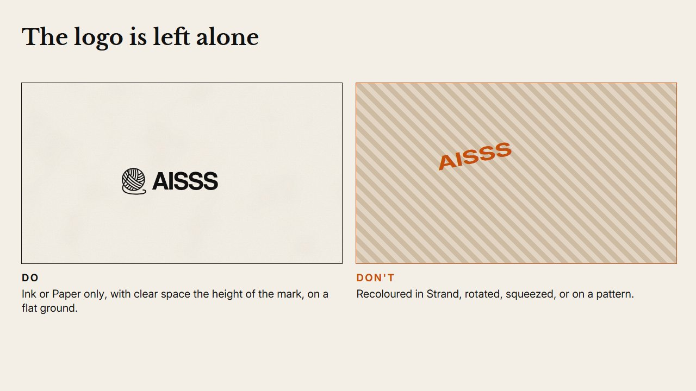
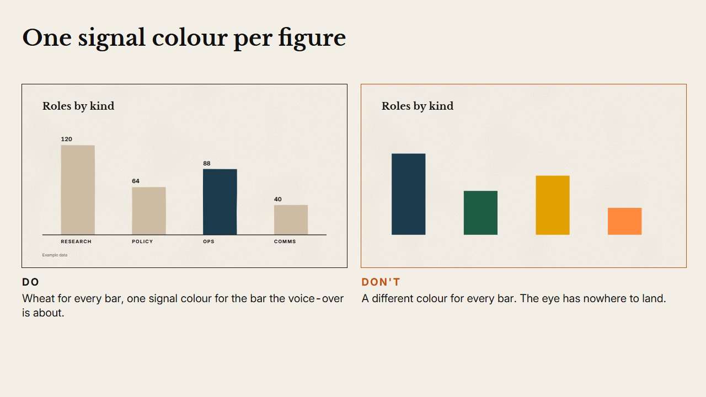
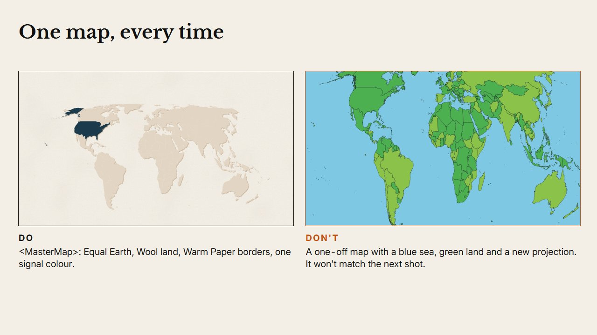

**Also don't:**

- Use stock video, 3D renders, emoji, clip-art or AI-generated images. (Stock photos are fine, through `public/images/stock/` and §8.2.)
- Show robots, glowing red eyes, skulls, "Terminator" imagery or other doom shorthand. Explain, don't alarm (PDF p.3).
- Put text on a photo. Put it on a panel next to the photo.
- Animate letters individually or type text on.
- Use a colour, size, duration or easing that isn't a token.
- Make a one-off version of a component because "it's just this shot".

---

## 15. Appendix

### 15.1 How the pieces fit (for the curious)

- **Boil:** `src/paper/Boil.tsx`. An SVG `feTurbulence` (fractal noise, frequency 0.012, 1 octave) feeds `feDisplacementMap` (scale = 2 × amount). The seed is `seed × 10 + floor(frame / 3) mod 3`, so the shape steps through 3 drawings on 3s.
- **Cut edges:** `src/paper/cut.ts`. Points every ~140 px along each edge, each nudged along the edge's normal by a seeded random amount, corners nudged half as much.
- **Grain:** `GrainTexture` in `src/paper/Ground.tsx` makes the texture from two fractal-noise layers tinted Bark (on Ink: Paper). It's rendered once to PNG.
- **Map:** `src/map/geo.ts` projects all countries once at load. `MasterMap` moves a camera transform; borders use non-scaling strokes; labels and pins are placed in screen space after projection, so they never scale.

### 15.2 Working with a coding agent

No plugin is needed. Codex reads `AGENTS.md`; Claude Code reads `CLAUDE.md`, which points to `AGENTS.md`. Remotion also publishes optional agent skills with general Remotion know-how; they're not required here, since `AGENTS.md` covers our rules.

A good prompt:

> Make shot S04-02-policy-map. Voice-over (starts at frame 0): "The rules are being written in four places: Washington, Sacramento, London and Brussels." Map from world to the Atlantic view, then pins on each city as it's named (≈ frames 60, 84, 104, 126). Then a lower third "Four capitals · so far / Where AI rules are being written" for 4 s. Follow AGENTS.md. Run `npm run check`, render stills at frames 40, 140 and 220, look at them, and fix anything off-brand before you finish.

Give the agent the voice-over line and timings, the components you want, and the shot id. Ask it to render stills and look at them.

### 15.3 If someone animates by hand (After Effects)

Not the main workflow, but if a shot must be made in After Effects, match the tokens exactly. The boil equivalent is a Turbulent Displace on the panel layer (Amount ≈ 3, Size ≈ 80, Complexity 1) with this on **Evolution**:

```js
// 3 drawings, redrawn every 3 frames at 24 fps (8 per second)
posterizeTime(8);
(Math.floor(time * 8) % 3) * 120;
```

Text layers and the logo never get the effect. Shadows are a duplicated shape layer filled Wheat, offset 6 or 12 px down-right, with no blur. Fonts: Inter and Libre Baskerville from `public/fonts/`. Render to ProRes 422 HQ, and get a review against this guide before the shot goes in.

### 15.4 Measuring a reference clip

To replace EST values with measured ones, put a reference clip in OneDrive `references/` and pull frames:

```bash
# one frame per source frame for 2 seconds, starting at 1:05
ffmpeg -ss 00:01:05 -t 2 -i clip.mp4 -vsync 0 frames/f_%03d.png
# how often the drawing changes: compare neighbours
ffmpeg -i clip.mp4 -vf "select='gt(scene,0.002)',showinfo" -f null - 2>&1 | grep pts_time
```

Measure: how many frames each drawing holds (boil rate), how far an edge moves between drawings (boil amount, in px at 1080p), entrance lengths in frames, shadow offset, and text sizes. Then update `tokens.ts`, change the tag from EST to "measured from <clip>", and re-render stills.

### 15.5 Open items (TBD)

| Item | Status |
|---|---|
| Boil rate and amount | EST until a reference clip is measured |
| Entrance durations and easing | EST |
| Type sizes | EST; check on a phone-sized YouTube player |
| Strand loop path | Approximation; replace with official `strand-drift.svg` |
| Licensed Baskerville | Using Libre Baskerville; swap in `fonts.ts` if licensed |
| Vertical (9:16) spec for shorts | Not started |
| Sound | Starting points only |
| Burned-in caption style | With the vertical spec |
